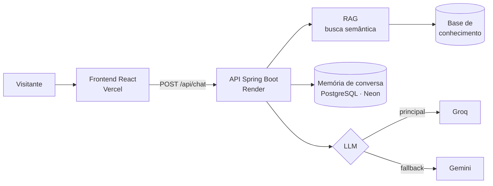

# About Me · Portfólio com o Theodor AI

Meu portfólio pessoal, com uma IA que eu construí para responder perguntas sobre
mim: trajetória, projetos, tecnologias e curiosidades.

**🔗 Acesse:** https://about-me-seven-lovat.vercel.app

O **Theodor AI** responde com base em uma base de conhecimento escrita por mim e
segue regras para não inventar o que não sabe. Por trás do chat há um backend em
Java com Spring Boot, busca semântica (RAG), memória de conversa e dois
provedores de modelos de linguagem.

## Funcionalidades

- **Chat com IA sobre mim**, com respostas em Markdown e sugestões de perguntas
  para continuar a conversa.
- **RAG próprio:** a base de conhecimento é dividida em trechos, transformada em
  embeddings e consultada por similaridade de cosseno antes de cada resposta.
- **Memória de conversa:** cada conversa tem um identificador, o histórico fica
  salvo no banco e as conversas longas são resumidas para controlar o contexto.
- **Dois provedores de IA:** o Groq responde primeiro, por ser mais rápido, e o
  Gemini assume se ele falhar.
- **Proteções da API pública:** limite de perguntas por minuto, por visitante e
  no total, validação do tamanho da pergunta e CORS restrito ao site.
- **Interface com identidade em pixel art:** fundo animado de pixels, chat em
  estilo terminal, modo claro e escuro e páginas próprias para 404, 500 e falta
  de conexão.

## Como funciona



1. A pergunta chega à API com o identificador da conversa.
2. O RAG busca os trechos da base de conhecimento mais parecidos com a pergunta,
   usando também as perguntas anteriores como contexto.
3. O histórico recente e o resumo da conversa são carregados do banco.
4. O modelo de linguagem recebe os trechos e o histórico e gera a resposta,
   que é salva e devolvida ao site.

## Tecnologias

| Camada | Tecnologias |
|---|---|
| Backend | Java 21, Spring Boot 4, Spring MVC, JPA/Hibernate, Maven |
| IA | Groq, Gemini (respostas e embeddings), RAG, similaridade de cosseno |
| Banco | PostgreSQL (produção, Neon), H2 (desenvolvimento local) |
| Frontend | React 19, Vite, react-markdown, Canvas para o fundo animado |
| Infra | Docker, Render (backend), Vercel (frontend) |

## Estrutura

```text
├── src/main/java/com/isaac/portfolioai
│   ├── controller    endpoints HTTP (/api/chat, /api/health)
│   ├── service       IA, RAG, embeddings, memória e persistência
│   ├── entity        entidades JPA
│   ├── repository    repositórios JPA
│   ├── model         modelos internos de conhecimento e memória
│   ├── dto           entrada e saída da API
│   └── config        CORS e limite de requisições
├── src/main/resources/knowledge   base de conhecimento em texto
├── frontend/                      site em React + Vite
├── Dockerfile                     imagem do backend
└── render.yaml                    configuração do Render
```

## Rodar localmente

Requisitos: JDK 21 e Node.js. O Maven não precisa ser instalado, porque o
projeto inclui o Maven Wrapper.

1. Copie `.env.example` para `.env` e preencha `GEMINI_API_KEY` e
   `GROQ_API_KEY`. Esse arquivo não é versionado.
2. Inicie o backend em um terminal PowerShell:

   ```powershell
   powershell -ExecutionPolicy Bypass -File .\backend.ps1 iniciar
   ```

3. Em outro terminal, inicie o frontend:

   ```powershell
   cd frontend
   npm.cmd ci
   npm.cmd run dev
   ```

4. Abra o endereço exibido pelo Vite. O frontend usa
   `http://localhost:8080/api/chat` por padrão. Para mudar, copie
   `frontend/.env.example` para `frontend/.env` e ajuste `VITE_CHAT_API_URL`.

Localmente, o banco H2 e o cache de embeddings ficam em `data/`. Na primeira
execução, o backend chama o Gemini para gerar os embeddings que ainda não estão
no cache.

Em desenvolvimento, `?erro=404`, `?erro=500` e `?erro=offline` no endereço do
site mostram cada estado de erro.

### Outros comandos do backend

```powershell
powershell -ExecutionPolicy Bypass -File .\backend.ps1 compilar
powershell -ExecutionPolicy Bypass -File .\backend.ps1 testar     # testes de persistência
powershell -ExecutionPolicy Bypass -File .\backend.ps1 empacotar  # gera o JAR sem testes
```

No VS Code, com o **Extension Pack for Java** e o **Spring Boot Extension Pack**,
pressione **F5** e escolha **PortfolioAI - Backend**. A configuração já carrega
o `.env`.

No frontend, `npm.cmd run build` e `npm.cmd run lint` validam o código.

## Publicação

O projeto roda nos planos gratuitos do Vercel, do Render e do Neon.

### Backend no Render

1. No Render, escolha **New > Blueprint** e selecione este repositório.
   O `render.yaml` cria o serviço com o `Dockerfile` da raiz.
2. Preencha as variáveis:
   - `GEMINI_API_KEY` e `GROQ_API_KEY`.
   - `ALLOWED_ORIGINS`: o endereço do frontend, sem barra no final. Vários
     endereços podem ser separados por vírgula.
   - `DB_URL`, `DB_USERNAME`, `DB_PASSWORD`: dados do Postgres. Se ficarem
     vazias, o backend usa H2 em disco temporário, e o histórico é apagado a
     cada reinício.
3. Teste `https://<seu-servico>.onrender.com/api/health`. A resposta deve ser `ok`.

No plano gratuito, o serviço "dorme" depois de cerca de 15 minutos sem acesso,
e a primeira pergunta depois disso pode levar até um minuto.

### Frontend no Vercel

1. Importe o repositório e escolha `frontend` em **Root Directory**.
2. Adicione `VITE_CHAT_API_URL=https://<seu-servico>.onrender.com/api/chat`.
3. Faça o deploy. Se mudar essa variável, faça um novo deploy, porque o Vite
   fixa o valor durante o build.

### Banco no Neon

1. Crie um projeto, abra **Connect** e desligue **Connection pooling**.
2. Converta a linha de conexão para o formato JDBC:
   `DB_URL=jdbc:postgresql://<host>/<banco>?sslmode=require`, com usuário e
   senha em `DB_USERNAME` e `DB_PASSWORD`.
3. As tabelas são criadas automaticamente na primeira inicialização.

### Variáveis opcionais

| Variável | Padrão | Uso |
|---|---|---|
| `CHAT_RATE_LIMIT_PER_MINUTE` | 15 | perguntas por minuto por visitante |
| `CHAT_GLOBAL_RATE_LIMIT_PER_MINUTE` | 120 | perguntas por minuto no total |
| `CHAT_MAX_MESSAGE_LENGTH` | 1000 | tamanho máximo da pergunta |

Tudo o que está em `src/main/resources/knowledge` pode ser revelado pela IA a
qualquer visitante.

## Outros projetos

- **[Desk-Friends](https://github.com/IsaacCastrooSilva/Desk-Friends)**: um
  display de mesa que mostra os agentes do Claude Code como invasores em pixel
  art e avisa quais estão trabalhando, esperando ou ociosos. Em desenvolvimento.

## Autor

**Isaac de Castro Silva**, desenvolvedor back-end ·
[GitHub](https://github.com/IsaacCastrooSilva)
